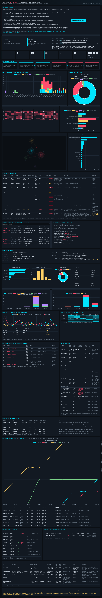

# X phishing campaign monitor — fake journalist / AI-lab interview → Calendly → X OAuth

**Live dashboard:** https://dutchosintguy.github.io/X-phising-campaign-monitor/
**Last updated:** 2026-10-17 06:25 CEST · updated automatically every 2 hours
**Alert feeds:** [RSS](https://dutchosintguy.github.io/X-phising-campaign-monitor/alerts.xml) · [JSON](https://dutchosintguy.github.io/X-phising-campaign-monitor/alerts.json)

Monitoring of an ongoing phishing campaign on X in which accounts posing as journalists (Bloomberg, TechCrunch, WIRED, Reuters) or AI-lab staff (OpenAI, Anthropic) publicly reply to mainly startup founders, AI/ML researchers and investors (also developers, crypto people, media/creators, security/OSINT people) ("I'm writing an article on … DM me"), move to DMs and send a **genuine Calendly link** that leads into a malicious X OAuth app (e.g. "Events Portal", "CalendarBookings", "Booking Pass") or a fake X sign-in page (e.g. "Twitta" on `plugins[.]cal-apis[.]com`) to take over accounts.

## What the monitor tracks
- operator accounts and their public lure replies on X (with status labels: confirmed by us vs reported by third parties)
- publicly approached accounts and their profile mix
- public victim warnings
- known phishing infrastructure plus newly spotted lookalike domains (live certificate-transparency watcher + DNS snapshots)
- passive status checks of known Calendly links and a register of the malicious X OAuth apps (Events Portal, CalendarBookings, Booking Pass)
- pipeline health: per-component heartbeat, error alerts and a stale-data warning
- infrastructure clusters A (Dominet HK) / B (Tucows, bill+paige Cloudflare NS, Twitta panel) / C (Asteria, Njalla NS) with registration timeline
- Twitta page-title watch (urlscan + passive title/CSS fingerprint) each run

## Sources
- [Nico Dekens / dutchosintguy (original investigation)](https://www.dutchosintguy.com/post/phishing-campaign-identified-how-osint-exposed-a-real-calendly-link-in-a-fake-bloomberg-interview-i)
- [Nosian Magazine](https://nosian.substack.com/p/scammers-on-x-impersonate-and-target)
- [Cybernews](https://cybernews.com/security/fake-journalist-calendly-account-takeover/)
- [Casco](https://casco.com/blog/how-my-unicorn-founder-friend-was-phished)
- [SafeBrowz](https://safebrowz.com/blog/calendly-x-oauth-booking-pass-scam-2026)
- [@orlof_v (Twitta HTML-title pivot, 16 Oct 2026)](https://x.com/orlof_v/status/2111081475277811880)

## Pipeline health (at build time)
| Component | Last success | Last error | State |
|---|---|---|---|
| ct_watcher | 2026-10-17 06:24 | 2026-10-14 02:28 | ok |
| calendly_watch | 2026-10-17 06:25 | — | ok |
| infra_watch | 2026-10-16 08:25 | — | ⚠ STALE |
| x_search | 2026-10-17 06:24 | 2026-10-16 02:26 | ok |
| gh_auth | 2026-10-13 10:26 | — | ⚠ STALE |
| build | 2026-10-17 06:25 | — | ok |
| publish | 2026-10-17 04:24 | — | ok |
| twitta_watch | 2026-10-17 06:25 | — | ok |

## Important caveats
- **Targets listed are publicly *approached* accounts, NOT confirmed victims.** A public reply from an operator account does not mean the person received a DM, clicked a link or was compromised.
- Accounts, apps and domains are labelled **confirmed by us** (e.g. lure posts observed, suspension or DNS checked) or **reported by third party** (published research or public X warnings, not all verified by us).
- Data gaps: no DM content; profile fields are API snapshots; suspended accounts have no profile data; coverage starts 2026-09-16 (earliest known reply 2026-08-19 is not in the dataset); CT/DNS history starts 2026-10-13; X OAuth app status is not publicly queryable; timezone and sector figures are estimates.
- Attribution: nothing here identifies who operates the accounts. Shared registrars/nameservers are clustering signals, not proof.
- Indicators are defanged. Calendly checks are passive page requests only — never submit forms, authorize apps or enter credentials.

## Data (`data/`)
`posts_clean.csv` · `operators.csv` (incl. source + verification) · `warnings.csv` · `targets_publicly_approached.csv` · `targets_profiles.csv` · `infra.csv` (CT + DNS + live CT watcher hits) · `profile_snapshots.csv` · `alerts.csv` · `apps.csv` · `calendly_watch.csv` · `heartbeat.csv` · `x_budget.csv` · `iocs.md`.

Times are Europe/Amsterdam.
